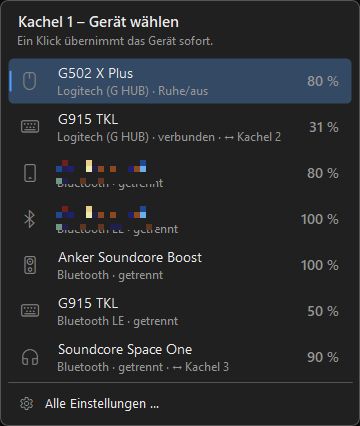
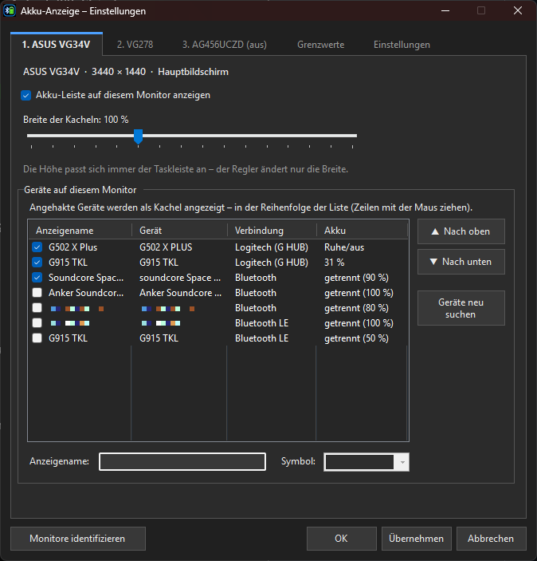
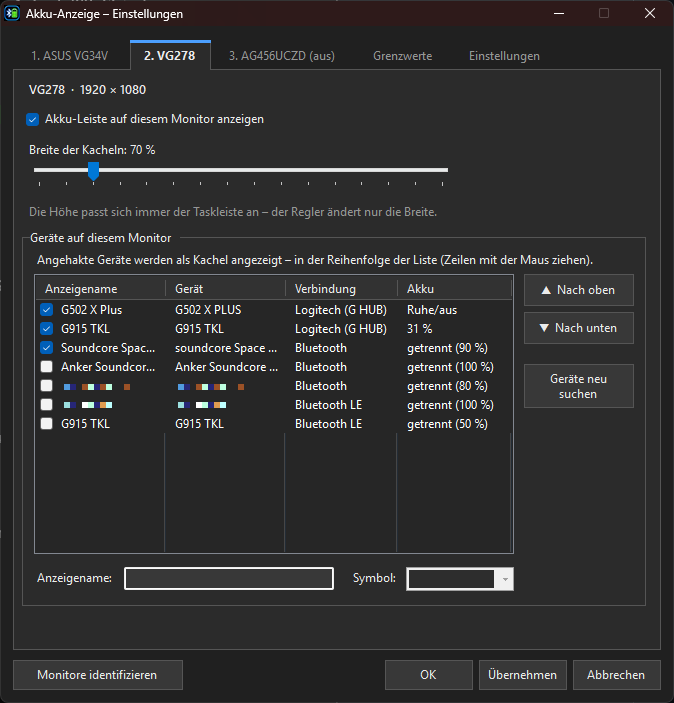
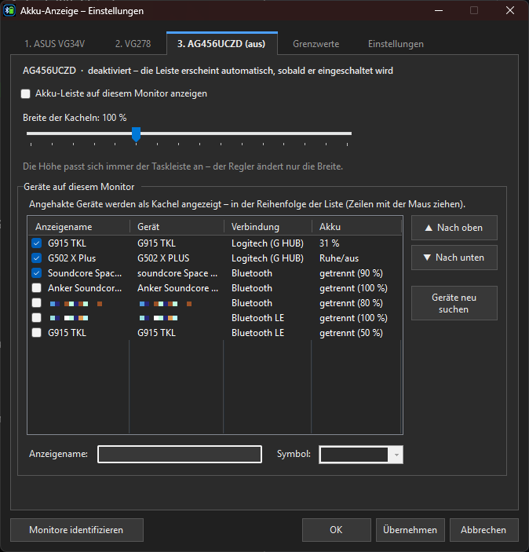
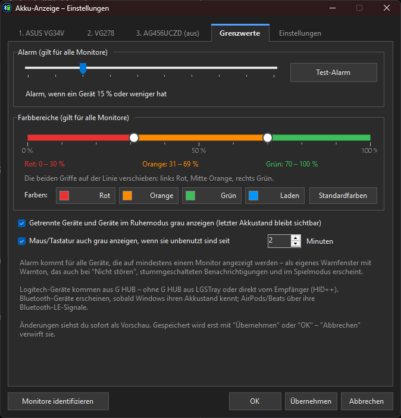
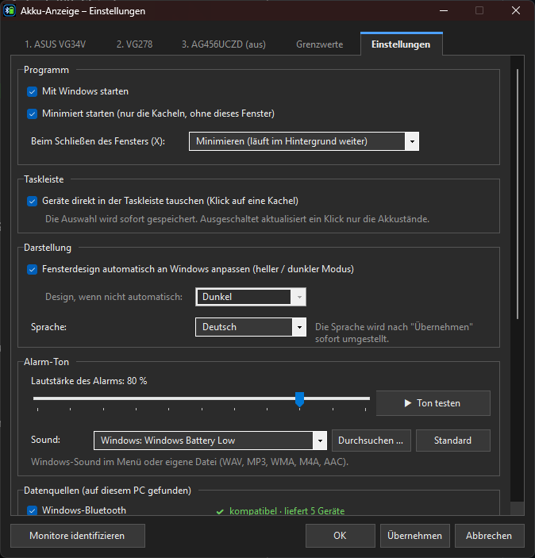
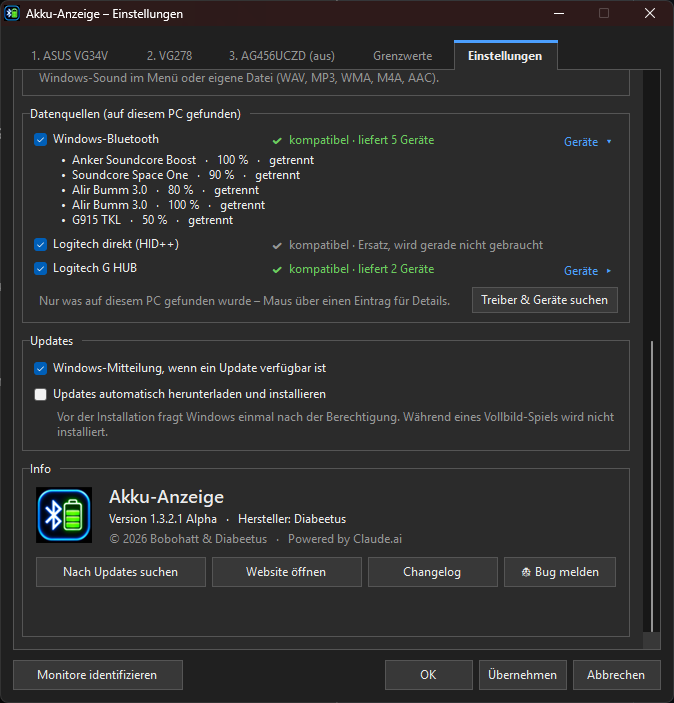
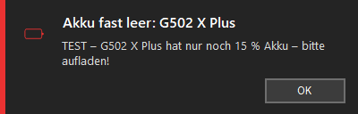
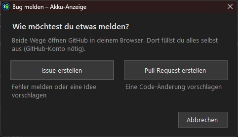
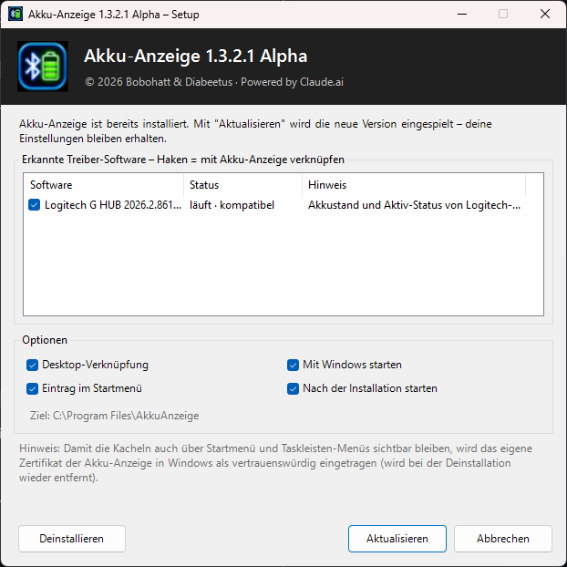

<p align="right"><a href="README.md">🇬🇧 English</a> | <b>🇩🇪 Deutsch</b></p>

# 🔋 Battery-Monitoring (Akku-Anzeige)

> ⚠️ **Alpha-Version 1.3.2.1** – das Programm ist noch in der Testphase. Fehler bitte als *Issue* melden.
>
> ℹ️ **Nicht alle Geräte und Hersteller können getestet werden.** Getestet wird mit den Geräten, die uns selbst zur Verfügung stehen (vor allem Logitech über G HUB / Empfänger und Bluetooth-Kopfhörer). Andere Hersteller und Modelle sind teils ungetestet – siehe [Unterstützte Datenquellen](#unterstützte-datenquellen). Wenn dein Gerät nicht oder falsch angezeigt wird, melde es gern als *Issue*.

### ⬇️ [Download: AkkuAnzeige-Setup-1.3.2.1-alpha.exe](https://github.com/Diabeetus94/Battery-Monitoring/releases)
*(Releases → neueste Version → Assets)*

**Akku-Anzeige** zeigt die Akkustände deiner drahtlosen Geräte – Maus, Tastatur, Kopfhörer, Lautsprecher, Controller … – als kleine Kacheln **direkt auf der Windows-Taskleiste**. Kein Öffnen von Hersteller-Apps mehr, kein Suchen im Infobereich: Du siehst jederzeit auf einen Blick, wie voll deine Akkus sind, und wirst rechtzeitig gewarnt, bevor einer leer ist.

**Hersteller:** Diabeetus · © 2026 Bobohatt & Diabeetus · *Powered by Claude.ai*


---

## Inhalt
- [Funktionen im Überblick](#funktionen-im-überblick)
- [Die Kacheln auf der Taskleiste](#die-kacheln-auf-der-taskleiste)
- [Einstellungen](#einstellungen)
  - [Monitor-Reiter](#monitor-reiter--jeder-monitor-einzeln)
  - [Grenzwerte](#reiter-grenzwerte)
  - [Einstellungen](#reiter-einstellungen)
- [Warnung bei niedrigem Akku](#warnung-bei-niedrigem-akku)
- [Info & Update-Suche](#info--update-suche)
- [Installation](#installation)
- [Unterstützte Datenquellen](#unterstützte-datenquellen)
- [Bedienung](#bedienung)
- [Selbst bauen](#selbst-bauen)
- [Bekannte Einschränkungen](#bekannte-einschränkungen-alpha)

---

## Funktionen im Überblick

| | |
|---|---|
| 🖥️ **Mehrere Monitore** | Jeder Monitor bekommt seine eigene Leiste mit eigenen Geräten, eigener Reihenfolge und eigener Breite – auch für Monitore, die gerade ausgeschaltet sind. |
| 🎨 **Farben nach Akkustand** | Grün / Orange / Rot – die Grenzen stellst du selbst auf einer Farblinie ein. Beim Laden blau. |
| 💤 **Standby-Erkennung** | Getrennte Geräte oder Geräte im Standby werden grau angezeigt – der zuletzt bekannte Akkustand bleibt sichtbar. |
| 🔔 **Eigener Alarm** | Eigenes Warnfenster mit Warnton auf allen Monitoren – kommt auch bei *Nicht stören*, stummgeschalteten Benachrichtigungen und im Spielmodus. |
| 🔊 **Alarm-Ton** | Lautstärke einstellbar, Standard-Warnton, alle Windows-Sounds oder eine eigene Datei (WAV, MP3, WMA, M4A, AAC). |
| 🌗 **Hell / Dunkel** | Das Fenster passt sich automatisch an den Windows-Modus an (oder fest hell / dunkel). |
| 🌍 **Sprachen** | Deutsch und Englisch. |
| 🎮 **Spiele** | Bei Vollbild-Spielen blendet sich die Leiste automatisch aus. |
| ↕️ **Automatisch ausblendende Taskleiste** | Bei *Taskleiste automatisch ausblenden* fahren die Kacheln mit der Taskleiste hoch und runter – ereignisgesteuert, ohne Abfrage-Timer, im Ruhezustand ohne CPU-Last. |
| 📌 **Immer sichtbar** | Bleibt auch über Startmenü, Infobereich-Menü und Schnelleinstellungen sichtbar. |
| 🔄 **Geräte in der Taskleiste tauschen** | Auf eine Kachel klicken und direkt dort ein anderes Gerät wählen – sofort gespeichert, ohne das Programm zu öffnen (abschaltbar). |
| 🔌 **Datenquellen mit Status** | Zeigt nur, was auf diesem PC gefunden wurde – mit Live-Status je Quelle (z. B. *kompatibel · liefert 2 Geräte*) und aufklappbarer Liste der gelieferten Geräte. |
| 🆕 **Update-Mitteilungen** | Windows-Mitteilung, wenn eine neue Version verfügbar ist; auf Wunsch automatische Updates (laden, prüfen, installieren). |

---

## Die Kacheln auf der Taskleiste

Die Leiste sitzt links auf der Taskleiste. Jede Kachel zeigt **Symbol, Gerätename, Prozentwert und einen Balken**.

**Hauptmonitor (Breite 100 %):**


**Zweiter Monitor mit schmaleren Kacheln (Breite 70 %)** – die Höhe passt sich immer der Taskleiste an, nur die Breite ändert sich. Ist eine Kachel schmal, wird der Balken weggelassen und lange Namen werden gekürzt:


| Farbe | Bedeutung |
|---|---|
| 🟢 Grün | Akku voll genug (Standard ab 70 %) |
| 🟠 Orange | mittel (Standard 30–69 %) |
| 🔴 Rot | niedrig (Standard unter 30 %) – unterhalb der Alarm-Grenze zusätzlich rot hinterlegt |
| 🔵 Blau | Gerät lädt |
| ⚪ Grau | Gerät getrennt / im Standby – letzter Akkustand bleibt stehen |

- **Linksklick** auf eine Kachel: Direkt darüber öffnet sich ein kleines Fenster mit allen Geräten – ein Klick setzt das gewählte Gerät in diese Kachel und speichert es sofort. Wird das Gerät schon in einer anderen Kachel angezeigt, tauschen die beiden Kacheln die Plätze (*↔ Kachel 2*). Abschaltbar unter *Einstellungen → Taskleiste*; dann aktualisiert ein Linksklick nur die Akkustände.
- **Rechtsklick**: Menü mit *Einstellungen*, *Info*, *Jetzt aktualisieren*, *Beenden* – im selben hellen / dunklen Design wie das Programm



---

## Einstellungen

Öffnen über die Desktop-Verknüpfung **Akku-Anzeige**, per Doppelklick auf das Symbol im Infobereich oder per Rechtsklick auf eine Kachel → *Einstellungen*.

> 💡 Alle Änderungen siehst du **sofort als Vorschau** auf den Kacheln. Gespeichert wird erst mit **Übernehmen** oder **OK** – **Abbrechen** verwirft sie.

### Monitor-Reiter – jeder Monitor einzeln

Für jeden Monitor gibt es einen eigenen Reiter – auch für ausgeschaltete oder abgesteckte Monitore („aus“). Deren Leiste erscheint automatisch, sobald der Monitor eingeschaltet wird.



- **Akku-Leiste auf diesem Monitor anzeigen** – Leiste an/aus pro Monitor
- **Breite der Kacheln** (50–200 %) – die Höhe richtet sich immer nach der Taskleiste
- **Geräteliste** – alle gefundenen drahtlosen Geräte mit Verbindung und Akkustand
  - ☑ **Haken** = Gerät wird als Kachel angezeigt
  - **Reihenfolge** per Maus ziehen oder mit *Nach oben / Nach unten*
  - **Anzeigename** und **Symbol** (Maus, Tastatur, Kopfhörer, Lautsprecher, Controller, Handy, Bluetooth) frei wählbar
  - *Geräte neu suchen* – neue Geräte sofort einlesen

Zweiter Monitor mit eigener Breite und eigener Geräteauswahl:



Ausgeschalteter Monitor – kann schon vorab eingerichtet werden:



Über **Monitore identifizieren** erscheint auf jedem Bildschirm kurz eine große Nummer mit Namen, damit du die Reiter zuordnen kannst.

### Reiter „Grenzwerte“



- **Alarm** – ab welchem Akkustand gewarnt wird (5–50 %), mit *Test-Alarm*
- **Farbbereiche** – eine Linie mit zwei Griffen teilt Rot / Orange / Grün auf; die aktuellen Bereiche stehen darunter
- **Farben** – Klick auf Rot, Orange, Grün oder Laden öffnet die Windows-Farbauswahl für eine eigene Farbe; *Standardfarbe* in der Farbauswahl bzw. *Standardfarben* daneben stellt die ursprünglichen Farben wieder her
- **Getrennte Geräte und Geräte im Ruhemodus grau anzeigen** – der letzte Akkustand bleibt sichtbar
- **Maus/Tastatur auch grau anzeigen, wenn sie unbenutzt sind seit … Minuten** – optional (z. B. wenn die Beleuchtung ausgeht, das Gerät aber noch verbunden ist)

### Reiter „Einstellungen“



- **Programm**
  - *Mit Windows starten*
  - *Minimiert starten* – nur die Kacheln, ohne Fenster
  - *Beim Schließen des Fensters (X)*: minimieren (läuft weiter) oder Programm komplett beenden
- **Taskleiste**
  - *Geräte direkt in der Taskleiste tauschen (Klick auf eine Kachel)* – siehe [Die Kacheln auf der Taskleiste](#die-kacheln-auf-der-taskleiste)
- **Darstellung**
  - *Fensterdesign automatisch an Windows anpassen* (hell / dunkel) oder fest wählen
  - *Sprache*: Deutsch / English
- **Alarm-Ton**
  - *Lautstärke* des Alarms (gilt für jedes Ausgabegerät)
  - *Sound*: Standard-Warnton, alle Windows-Sounds oder eigene Datei über *Durchsuchen …*
  - *Ton testen*
Weiter unten auf derselben Seite:



- **Datenquellen (auf diesem PC gefunden)** – nur, was es auf diesem PC wirklich gibt: eingebaute Lesewege erscheinen nur, wenn passende Hardware angeschlossen ist, Hersteller-Software nur, wenn sie installiert ist. Jede Quelle zeigt einen Live-Status (siehe [Statusmeldungen](#statusmeldungen-der-datenquellen)). Ein Klick auf **Geräte ▸** zeigt, welche Geräte eine Quelle liefert – mit Akkustand und Zustand. *Treiber & Geräte suchen* findet nachträglich installierte Software und Geräte: neue erscheinen mit *(neu)* – anhaken und *Übernehmen*, ohne Neuinstallation.
- **Updates**
  - *Windows-Mitteilung, wenn ein Update verfügbar ist* – etwa eine Minute nach dem Start und danach alle 6 Stunden; ein Klick auf die Mitteilung öffnet das Update-Fenster
  - *Updates automatisch herunterladen und installieren* (standardmäßig aus) – Windows fragt einmal nach der Berechtigung; während eines Vollbild-Spiels wird nicht installiert
- **Info** – Version, Hersteller, *Nach Updates suchen*, *Website öffnen*, *Changelog*, *Bug melden* (siehe [Info & Update-Suche](#info--update-suche))

---

## Warnung bei niedrigem Akku

Fällt ein Gerät unter die Alarm-Grenze, erscheint auf **jedem Monitor** unten rechts ein eigenes Warnfenster – immer im Vordergrund, ohne einem laufenden Spiel den Fokus zu nehmen – zusammen mit dem gewählten Warnton:



Die Warnung läuft **nicht** über das Windows-Benachrichtigungssystem und kommt deshalb auch bei *Nicht stören*, stummgeschalteten Benachrichtigungen und im Spielmodus. Pro Gerät einmal – erneut erst, nachdem es wieder geladen wurde. *OK* schließt alle Warnfenster und stoppt den Ton.

---

## Info & Update-Suche

Der Bereich **Info** steht ganz unten im Reiter *Einstellungen* (oder Rechtsklick auf eine Kachel → *Info*):

- Version und Hersteller
- **Nach Updates suchen** – findet neue Versionen; **Update installieren** lädt sie direkt in der App herunter, prüft sie (Signatur + Prüfsumme) und installiert sie – ohne Browser
- **Changelog** – zeigt alle Änderungen direkt in der App (auch als [CHANGELOG.de.md](CHANGELOG.de.md))
- **Bug melden** – kleines Fenster mit zwei Wegen zu GitHub: *Issue erstellen* (Fehler melden, Idee vorschlagen) oder *Pull Request erstellen* (Code-Änderung vorschlagen). Ausgefüllt wird alles auf GitHub (GitHub-Konto nötig).
- **Website öffnen** – öffnet diese Seite



Außerdem sucht die App selbst nach Updates und zeigt eine **Windows-Mitteilung**, wenn eine neue Version da ist – oder installiert sie automatisch, wenn du das eingeschaltet hast (*Einstellungen → Updates*).

---

## Installation

1. Unter **[Releases](https://github.com/Diabeetus94/Battery-Monitoring/releases)** die Datei `AkkuAnzeige-Setup-<version>.exe` herunterladen und starten.
2. Das Setup zeigt die **installierte, kompatible Treiber-Software** – mit Haken wird sie verknüpft.
3. Optionen wählen (Desktop-Verknüpfung, Startmenü, Mit Windows starten) → **Installieren**.



- Installiert nach `C:\Program Files\AkkuAnzeige`, Eintrag unter *Apps & Features* zum Deinstallieren.
- Ist schon eine Version installiert, wird sie **aktualisiert** – Einstellungen bleiben erhalten.
- Wird kompatible Software erst **nach** der Installation installiert, fragt die Akku-Anzeige von selbst, ob sie verknüpft werden soll.
- Das Setup folgt der Windows-Sprache; mit `/lang=de` bzw. `/lang=en` lässt sich die Sprache erzwingen.

> ℹ️ Damit die Kacheln auch über Startmenü und Taskleisten-Menüs sichtbar bleiben, nutzt die App die Windows-Funktion *UIAccess*. Dafür trägt das Setup das eigene Zertifikat der Akku-Anzeige als vertrauenswürdig ein – bei der Deinstallation wird es wieder entfernt. Beim ersten Start zeigt Windows evtl. „Der Computer wurde durch Windows geschützt“: **Weitere Informationen → Trotzdem ausführen**.

---

## Unterstützte Datenquellen

| Quelle | Status | Was wird gelesen |
|---|---|---|
| **Logitech G HUB** | ✅ kompatibel | Akkustand, Laden, Aktiv / Standby / Aus |
| **Windows-Bluetooth** (eingebaut) | ✅ kompatibel | Akkustand von Kopfhörern, Lautsprechern, Handys … |
| **LGSTray** | ✅ Ersatzquelle | Logitech-Akkustände, falls G HUB nicht läuft |
| **Logitech direkt** (HID++, eingebaut) | ✅ kompatibel | LIGHTSPEED-/Unifying-/Bolt-Empfänger und USB-Geräte ohne G HUB: Name, Typ, Akkustand, Laden, An / Aus |
| **HyperX direkt** (eingebaut) | ✅ kompatibel | Cloud III S Wireless (Dongle `03F0:06BE` / `02CC`) ohne NGENUITY: Akkustand, Laden, An / Aus |
| **PlayStation DualSense** (eingebaut) | ✅ kompatibel | USB immer; Bluetooth, sobald ein Programm wie Steam den Controller auf den vollen Bericht umgeschaltet hat (nur passives Mitlesen) |
| **AirPods / Beats** (Bluetooth LE, eingebaut) | ✅ kompatibel | Akkustand der Ohrhörer aus ihren Bluetooth-LE-Signalen (der leerere zählt); sucht nur, solange ein Apple-Audiogerät verbunden ist |
| Razer Synapse, Corsair iCUE, SteelSeries GG, HyperX NGENUITY, ASUS Armoury Crate, Logitech Options+ | 🔍 wird erkannt | erscheint als *installiert – aber nicht kompatibel*; Akkustände noch nicht unterstützt |

Alle eingebauten Quellen *lesen* nur – sie ändern keine Einstellungen am Gerät. Unter *Einstellungen → Datenquellen* stehen nur die Quellen, die auf diesem PC gefunden wurden.

### Statusmeldungen der Datenquellen

| Meldung | Bedeutung |
|---|---|
| ✔ **kompatibel · liefert 2 Geräte** (grün) | funktioniert, Akkustände kommen an – *Geräte ▸* zeigt, welche |
| ✔ kompatibel · zurzeit kein Gerät eingeschaltet | Verbindung klappt, aber gerade ist kein Gerät an (z. B. Maus aus, Empfänger abgezogen) |
| ✔ kompatibel · Ersatz, wird gerade nicht gebraucht | Ersatzquelle, z. B. *Logitech direkt*, solange G HUB läuft |
| ⚠ **kompatibel · Programm läuft nicht** (orange) | z. B. G HUB ist installiert, aber nicht gestartet |
| ⚠ **kompatibel · antwortet gerade nicht** (orange) | das Programm läuft, gibt aber keine Antwort (z. B. während es sich aktualisiert) |
| – kompatibel · ausgeschaltet | du hast den Haken herausgenommen |
| ✖ **installiert – aber nicht kompatibel** (grau, ohne Haken) | z. B. Razer Synapse oder Corsair iCUE: erkannt, aber Akkustände können wir daraus noch nicht lesen |

Der Status wird alle 5 Sekunden aktualisiert, solange das Fenster offen ist.

> ℹ️ **Hinweis zu anderen Herstellern:** Wir können nicht jedes Gerät und jeden Hersteller selbst testen. Razer, Corsair, SteelSeries, ASUS und weitere Hersteller geben die Akkustände ihrer Geräte meist nicht für andere Programme frei – Unterstützung dafür ist geplant, kann aber nur mit Testgeräten zuverlässig umgesetzt werden. Hast du ein solches Gerät und möchtest beim Testen helfen? Melde dich gern über ein *Issue*.

---

## Bedienung

| Aktion | Wie |
|---|---|
| Einstellungen öffnen | Desktop-Verknüpfung · Doppelklick auf Infobereich-Symbol · Rechtsklick auf Kachel |
| Gerät einer Kachel tauschen | Linksklick auf die Kachel → Gerät wählen |
| Sofort aktualisieren | Rechtsklick auf eine Kachel → *Jetzt aktualisieren* (oder Linksklick, wenn das Tauschen ausgeschaltet ist) |
| Reiter wechseln | Klick oder `Strg + Tab` |
| Programm beenden | Rechtsklick auf Kachel oder Infobereich-Symbol → *Beenden* |
| Deinstallieren | *Einstellungen → Apps → Akku-Anzeige → Deinstallieren* |

Einstellungen werden unter `%APPDATA%\AkkuAnzeige\settings.json` gespeichert.

---

## Selbst bauen

Voraussetzungen: Windows 10/11 mit .NET Framework 4.8 (der eingebaute Compiler `csc.exe` reicht – kein Visual Studio nötig).

```powershell
powershell -ExecutionPolicy Bypass -File src\build.ps1 -noinstall
```

Das Skript kompiliert App und Setup, signiert beide mit dem lokalen Zertifikat „Akku-Anzeige Code Signing (lokal)“ und legt das Setup unter `Setup\` ab. Ohne `-noinstall` wird zusätzlich lokal nach `Program Files` installiert (UAC-Abfrage).

| Datei | Inhalt |
|---|---|
| `src/AkkuAnzeige.cs` | Datenquellen (G HUB, LGSTray, Bluetooth), Taskleisten-Verfolgung, Monitor-Erkennung, Eingabe-Aktivität |
| `src/Hid.cs` | direkter HID-Zugriff (Aufzählen, Lesen/Schreiben mit Timeout) |
| `src/LogiHidpp.cs` | Logitech HID++ 2.0 (Empfänger und USB-Geräte) |
| `src/DirectHid.cs` | HyperX Cloud III S Wireless, DualSense |
| `src/AppleBle.cs` | AirPods / Beats über Bluetooth-LE-Werbepakete (WinRT) |
| `src/Ui.cs` | Kacheln, Einstellungsfenster, Design, Alarm |
| `src/Info.cs` | Info-Fenster und Update-Suche |
| `src/Lang.cs` | Übersetzungen |
| `src/Vendors.cs` | Erkennung installierter Treiber-Software, Verknüpfungen |
| `src/Setup.cs` | Installationsprogramm |
| `src/AssemblyInfo.cs` | Version und Hersteller (gemeinsam für App und Setup) |

---

## Bekannte Einschränkungen (Alpha)

- Akkustände von Razer, Corsair, SteelSeries, ASUS und anderen HyperX-Headsets werden noch nicht gelesen. NuPhy-Tastaturen (2,4-GHz-Dongle `19F5:2620`) lassen sich ebenfalls nicht auslesen – NuPhys Protokoll ist verschlüsselt, und NuPhys eigene Software zeigt den Akku dieser Modelle selbst nicht an.
- DualSense über Bluetooth zeigt nur einen Akkustand, solange ein Programm wie Steam den Controller nutzt (selbst umschalten würde DirectInput-Spiele stören, bis der Controller aus- und wieder eingeschaltet wird).
- Bei Spielen im **exklusiven** Vollbild kann kein Fenster darüber erscheinen – dort hörst du nur den Warnton (randloses Vollbild funktioniert).
- Logitech-Standby wird erkannt, sobald sich das Gerät vom Empfänger trennt; wenn nur die Beleuchtung ausgeht, gilt es noch als aktiv (optional einstellbar).

---

<sub>Akku-Anzeige · © 2026 Bobohatt & Diabeetus · Powered by Claude.ai</sub>
