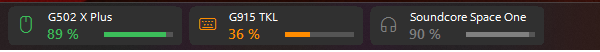
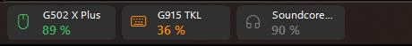
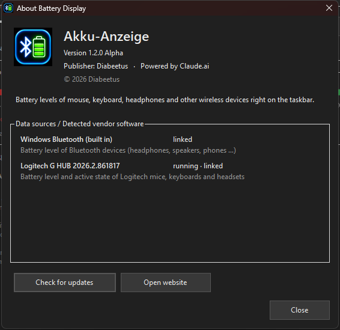

<p align="right"><b>🇬🇧 English</b> | <a href="README.de.md">🇩🇪 Deutsch</a></p>

# 🔋 Battery-Monitoring (Akku-Anzeige)

> ⚠️ **Alpha version 1.2.0.1** – the program is still being tested. Please report bugs as an *Issue*.

### ⬇️ [Download: AkkuAnzeige-Setup-1.2.0.1-alpha.exe](https://github.com/Diabeetus94/Battery-Monitoring/releases)
*(Releases → latest version → Assets)*

**Akku-Anzeige** ("Battery Display") shows the battery levels of your wireless devices – mouse, keyboard, headphones, speakers, controllers … – as small tiles **right on the Windows taskbar**. No more opening vendor apps or digging through the notification area: you always see at a glance how full your batteries are, and you get warned before one runs empty.

**Publisher:** Diabeetus · © 2026 · *Powered by Claude.ai*



---

## Contents
- [Features at a glance](#features-at-a-glance)
- [The tiles on the taskbar](#the-tiles-on-the-taskbar)
- [Settings](#settings)
  - [Monitor tabs](#monitor-tabs--each-monitor-individually)
  - [Thresholds](#thresholds-tab)
  - [Settings](#settings-tab)
- [Low battery warning](#low-battery-warning)
- [About & update check](#about--update-check)
- [Installation](#installation)
- [Supported data sources](#supported-data-sources)
- [Usage](#usage)
- [Building it yourself](#building-it-yourself)
- [Known limitations](#known-limitations-alpha)

---

## Features at a glance

| | |
|---|---|
| 🖥️ **Multiple monitors** | Every monitor gets its own bar with its own devices, order and width – even monitors that are currently switched off. |
| 🎨 **Colors by battery level** | Green / orange / red – you set the boundaries yourself on a color line. Blue while charging. |
| 💤 **Standby detection** | Disconnected or sleeping devices are shown in gray – the last known battery level stays visible. |
| 🔔 **Own alarm** | Its own warning window with a warning sound on all monitors – appears even with *Do not disturb*, muted notifications and in game mode. |
| 🔊 **Alarm sound** | Adjustable volume, default warning tone, any Windows sound or your own file (WAV, MP3, WMA, M4A, AAC). |
| 🌗 **Light / dark** | The window follows the Windows light/dark mode automatically (or fixed light / dark). |
| 🌍 **Languages** | English and German. |
| 🎮 **Games** | The bar hides automatically during fullscreen games. |
| 📌 **Always visible** | Stays visible above the Start menu, the notification area menu and Quick Settings. |
| 🔌 **Driver detection** | Detects installed, compatible driver software (e.g. Logitech G HUB) and asks whether to link it. |

---

## The tiles on the taskbar

The bar sits on the left side of the taskbar. Each tile shows **icon, device name, percentage and a bar**.

**Main monitor (width 100 %):**


**Second monitor with narrower tiles (width 70 %)** – the height always matches the taskbar, only the width changes. On narrow tiles the bar is left out and long names are shortened:



| Color | Meaning |
|---|---|
| 🟢 Green | battery high enough (default from 70 %) |
| 🟠 Orange | medium (default 30–69 %) |
| 🔴 Red | low (default below 30 %) – additionally highlighted red below the alarm threshold |
| 🔵 Blue | device is charging |
| ⚪ Gray | device disconnected / in standby – last battery level stays visible |

- **Left-click** a tile: refresh immediately
- **Right-click**: menu with *Settings*, *About*, *Refresh now*, *Exit*

---

## Settings

Open via the desktop shortcut **Akku-Anzeige**, by double-clicking the icon in the notification area, or right-click a tile → *Settings*.

> 💡 Every change is shown **immediately as a preview** on the tiles. It is only saved with **Apply** or **OK** – **Cancel** discards it.

### Monitor tabs – each monitor individually

There is one tab per monitor – including monitors that are switched off or unplugged ("off"). Their bar appears automatically as soon as the monitor is switched on.


- **Show battery bar on this monitor** – bar on/off per monitor
- **Tile width** (50–200 %) – the height always follows the taskbar
- **Device list** – all wireless devices found, with connection and battery level
  - ☑ **Checked** = device is shown as a tile
  - **Order** by dragging with the mouse or with *Move up / Move down*
  - **Display name** and **icon** (mouse, keyboard, headphones, speaker, controller, phone, Bluetooth) freely selectable
  - *Search devices* – read in new devices immediately

Second monitor with its own width and its own device selection:


Switched-off monitor – can be set up in advance:


**Identify monitors** briefly shows a large number with the monitor name on every screen, so you can match the tabs to your screens.

### Thresholds tab


- **Alarm** – at which battery level you are warned (5–50 %), with *Test alarm*
- **Color ranges** – a line with two handles splits red / orange / green; the current ranges are shown below
- **Show disconnected and sleeping devices in gray** – the last battery level stays visible
- **Also show mouse/keyboard in gray when unused for … minutes** – optional (e.g. when the lighting turns off but the device is still connected)

### Settings tab


- **Program**
  - *Start with Windows*
  - *Start minimized* – tiles only, without the window
  - *When closing the window (X)*: minimize (keeps running) or exit the program completely
- **Appearance**
  - *Match window design to Windows automatically* (light / dark) or choose a fixed one
  - *Language*: English / Deutsch
- **Alarm sound**
  - *Alarm volume* (applies to every output device)
  - *Sound*: default warning tone, any Windows sound, or your own file via *Browse …*
  - *Test sound*
- **Data sources** – which installed, compatible driver software is linked

---

## Low battery warning

When a device drops below the alarm threshold, a warning window appears at the bottom right of **every monitor** – always on top, without taking focus away from a running game – together with the chosen warning sound:


The warning does **not** use the Windows notification system, so it also appears with *Do not disturb*, muted notifications and in game mode. Once per device – again only after it has been charged. *OK* closes all warning windows and stops the sound.

---

## About & update check

Via **ⓘ About** in the settings window (or right-click → *About*):



- Version, publisher, data sources and detected driver software
- **Check for updates** – queries the releases of this project *(works once the project is public)*
- **Open website** – opens this page

---

## Installation

1. Download `AkkuAnzeige-Setup-<version>.exe` from **[Releases](https://github.com/Diabeetus94/Battery-Monitoring/releases)** and run it.
2. The setup lists the **installed, compatible driver software** – checked entries are linked.
3. Choose options (desktop shortcut, Start menu, start with Windows) → **Install**.


- Installs to `C:\Program Files\AkkuAnzeige`, with an entry in *Apps & features* for uninstalling.
- If a version is already installed, it is **updated** – your settings are kept.
- If compatible software is installed **after** the installation, Akku-Anzeige asks on its own whether to link it.
- The setup follows the Windows language; force a language with `/lang=en` or `/lang=de`.

> ℹ️ To keep the tiles visible above the Start menu and taskbar menus, the app uses the Windows *UIAccess* feature. For this, the setup adds Akku-Anzeige's own certificate to Windows' trusted certificates – it is removed again on uninstall. Windows may show "Windows protected your PC" on first launch: click **More info → Run anyway**.

---

## Supported data sources

| Source | Status | What is read |
|---|---|---|
| **Logitech G HUB** | ✅ compatible | battery level, charging, active / standby / off |
| **Windows Bluetooth** (built in) | ✅ compatible | battery level of headphones, speakers, phones … |
| **LGSTray** | ✅ fallback | Logitech battery levels if G HUB is not running |
| Razer Synapse, Corsair iCUE, SteelSeries GG, HyperX NGENUITY, ASUS Armoury Crate, Logitech Options+ | 🔍 detected | battery levels not supported yet |

---

## Usage

| Action | How |
|---|---|
| Open settings | desktop shortcut · double-click the notification area icon · right-click a tile |
| Refresh immediately | left-click a tile |
| Switch tabs | click or `Ctrl + Tab` |
| Exit | right-click a tile or the notification area icon → *Exit* |
| Uninstall | *Settings → Apps → Akku-Anzeige → Uninstall* |

Settings are stored in `%APPDATA%\AkkuAnzeige\settings.json`.

---

## Building it yourself

Requirements: Windows 10/11 with .NET Framework 4.8 (the built-in compiler `csc.exe` is enough – no Visual Studio needed).

```powershell
powershell -ExecutionPolicy Bypass -File src\build.ps1 -noinstall
```

The script compiles the app and the setup, signs both with the local certificate "Akku-Anzeige Code Signing (lokal)" and puts the setup into `Setup\`. Without `-noinstall` it also installs locally to `Program Files` (UAC prompt).

| File | Content |
|---|---|
| `src/AkkuAnzeige.cs` | data sources (G HUB, LGSTray, Bluetooth), monitor detection, input activity |
| `src/Ui.cs` | tiles, settings window, design, alarm |
| `src/Info.cs` | About window and update check |
| `src/Lang.cs` | translations |
| `src/Vendors.cs` | detection of installed driver software, links |
| `src/Setup.cs` | installer |
| `src/AssemblyInfo.cs` | version and publisher (shared by app and setup) |

---

## Known limitations (Alpha)

- Battery levels from Razer, Corsair, SteelSeries, HyperX and ASUS are not read yet.
- In games running in **exclusive** fullscreen no window can appear on top – you only hear the warning sound there (borderless fullscreen works).
- Logitech standby is detected as soon as the device disconnects from its receiver; if only the lighting turns off, it still counts as active (optionally adjustable).
- The automatic update check only works once this project is public.

---

<sub>Akku-Anzeige · Diabeetus · © 2026 · Powered by Claude.ai</sub>
