<p align="right"><b>🇬🇧 English</b> | <a href="README.de.md">🇩🇪 Deutsch</a></p>

# 🔋 Battery-Monitoring (Akku-Anzeige)

> ⚠️ **Alpha version 1.3.2.1** – the program is still being tested. Please report bugs as an *Issue*.
>
> ℹ️ **Not every device and manufacturer can be tested.** Testing is done with the devices we have ourselves (mainly Logitech via G HUB / receiver and Bluetooth headphones). Other manufacturers and models are partly untested – see [Supported data sources](#supported-data-sources). If your device is missing or shown incorrectly, please report it as an *Issue*.

### ⬇️ [Download: AkkuAnzeige-Setup-1.3.2.1-alpha.exe](https://github.com/Diabeetus94/Battery-Monitoring/releases)
*(Releases → latest version → Assets)*

**Akku-Anzeige** ("Battery Display") shows the battery levels of your wireless devices – mouse, keyboard, headphones, speakers, controllers … – as small tiles **right on the Windows taskbar**. No more opening vendor apps or digging through the notification area: you always see at a glance how full your batteries are, and you get warned before one runs empty.

**Publisher:** Diabeetus · © 2026 Bobohatt & Diabeetus · *Powered by Claude.ai*


---

## Contents
- [Features at a glance](#features-at-a-glance)
- [The tiles on the taskbar](#the-tiles-on-the-taskbar)
- [Settings](#settings)
  - [Monitor tabs](#monitor-tabs--each-monitor-individually)
  - [Thresholds](#thresholds-tab)
  - [Settings](#settings-tab)
- [Low battery warning](#low-battery-warning)
- [About & update check](#about--update-check)
- [Installation](#installation)
- [Supported data sources](#supported-data-sources)
- [Usage](#usage)
- [Building it yourself](#building-it-yourself)
- [Known limitations](#known-limitations-alpha)

---

## Features at a glance

| | |
|---|---|
| 🖥️ **Multiple monitors** | Every monitor gets its own bar with its own devices, order and width – even monitors that are currently switched off. |
| 🎨 **Colors by battery level** | Green / orange / red – you set the boundaries yourself on a color line. Blue while charging. |
| 💤 **Standby detection** | Disconnected or sleeping devices are shown in gray – the last known battery level stays visible. |
| 🔔 **Own alarm** | Its own warning window with a warning sound on all monitors – appears even with *Do not disturb*, muted notifications and in game mode. |
| 🔊 **Alarm sound** | Adjustable volume, default warning tone, any Windows sound or your own file (WAV, MP3, WMA, M4A, AAC). |
| 🌗 **Light / dark** | The window follows the Windows light/dark mode automatically (or fixed light / dark). |
| 🌍 **Languages** | English and German. |
| 🎮 **Games** | The bar hides automatically during fullscreen games. |
| ↕️ **Auto-hide taskbar** | With *Automatically hide the taskbar* the tiles slide up and down together with the taskbar – event-driven, no polling, no CPU load while idle. |
| 📌 **Always visible** | Stays visible above the Start menu, the notification area menu and Quick Settings. |
| 🔄 **Swap devices on the taskbar** | Click a tile and pick another device right there – saved instantly, no need to open the program (can be turned off). |
| 🔌 **Data sources with status** | Shows only what was found on this PC – with a live status for each source (e.g. *compatible · delivers 2 devices*) and an expandable list of the delivered devices. |
| 🆕 **Update notifications** | Windows notification when a new version is available; optional automatic updates (download, verify, install). |

---

## The tiles on the taskbar

The bar sits on the left side of the taskbar. Each tile shows **icon, device name, percentage and a bar**.

**Main monitor (width 100 %):**


**Second monitor with narrower tiles (width 70 %)** – the height always matches the taskbar, only the width changes. On narrow tiles the bar is left out and long names are shortened:


| Color | Meaning |
|---|---|
| 🟢 Green | battery high enough (default from 70 %) |
| 🟠 Orange | medium (default 30–69 %) |
| 🔴 Red | low (default below 30 %) – additionally highlighted red below the alarm threshold |
| 🔵 Blue | device is charging |
| ⚪ Gray | device disconnected / in standby – last battery level stays visible |

- **Left-click** a tile: a small window opens right above it with all devices – one click puts the chosen device into this tile and saves it immediately. If the device is already shown on another tile, the two tiles swap places (*↔ tile 2*). Can be turned off under *Settings → Taskbar*; then a left-click just refreshes the battery levels.
- **Right-click**: menu with *Settings*, *About*, *Refresh now*, *Exit* – in the same light / dark design as the program

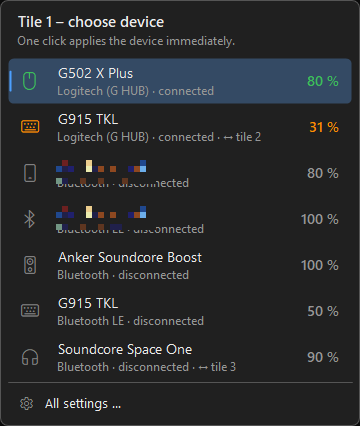

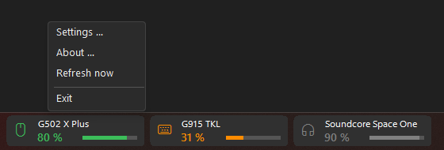

---

## Settings

Open via the desktop shortcut **Akku-Anzeige**, by double-clicking the icon in the notification area, or right-click a tile → *Settings*.

> 💡 Every change is shown **immediately as a preview** on the tiles. It is only saved with **Apply** or **OK** – **Cancel** discards it.

### Monitor tabs – each monitor individually

There is one tab per monitor – including monitors that are switched off or unplugged ("off"). Their bar appears automatically as soon as the monitor is switched on.

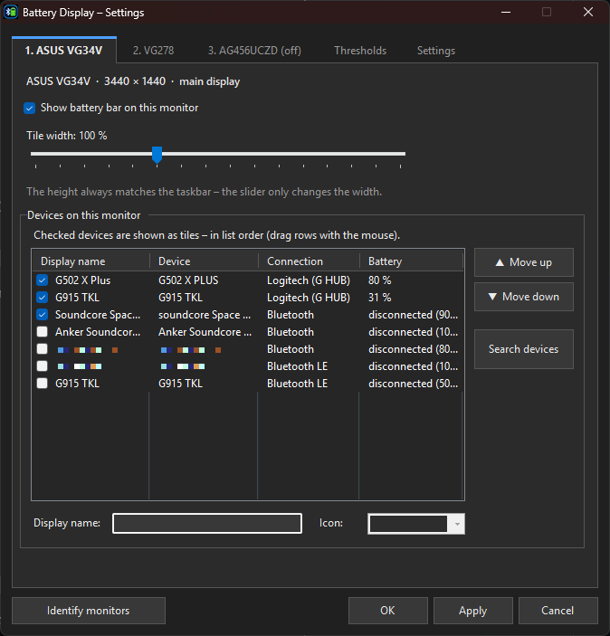

- **Show battery bar on this monitor** – bar on/off per monitor
- **Tile width** (50–200 %) – the height always follows the taskbar
- **Device list** – all wireless devices found, with connection and battery level
  - ☑ **Checked** = device is shown as a tile
  - **Order** by dragging with the mouse or with *Move up / Move down*
  - **Display name** and **icon** (mouse, keyboard, headphones, speaker, controller, phone, Bluetooth) freely selectable
  - *Search devices* – read in new devices immediately

Second monitor with its own width and its own device selection:

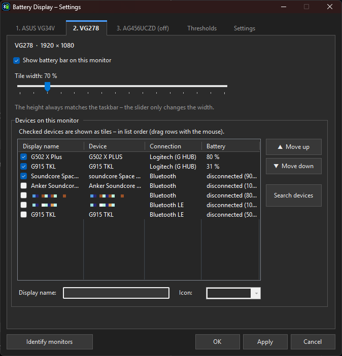

Switched-off monitor – can be set up in advance:

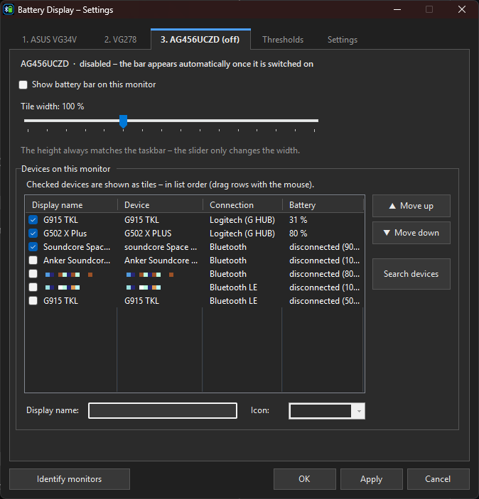

**Identify monitors** briefly shows a large number with the monitor name on every screen, so you can match the tabs to your screens.

### Thresholds tab

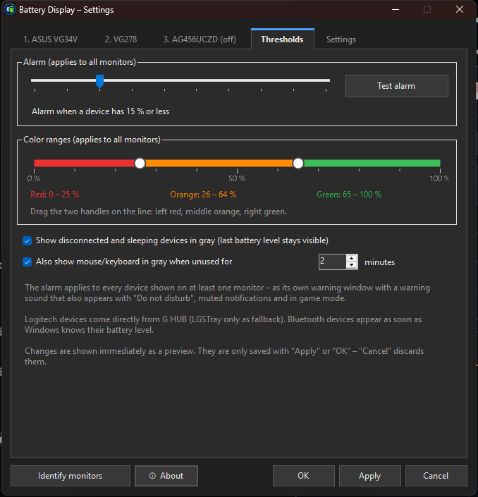

- **Alarm** – at which battery level you are warned (5–50 %), with *Test alarm*
- **Color ranges** – a line with two handles splits red / orange / green; the current ranges are shown below
- **Colors** – click red, orange, green or charging to pick your own color in the Windows color picker; *Default color* in the picker or *Default colors* next to it restores the original colors
- **Show disconnected and sleeping devices in gray** – the last battery level stays visible
- **Also show mouse/keyboard in gray when unused for … minutes** – optional (e.g. when the lighting turns off but the device is still connected)

### Settings tab

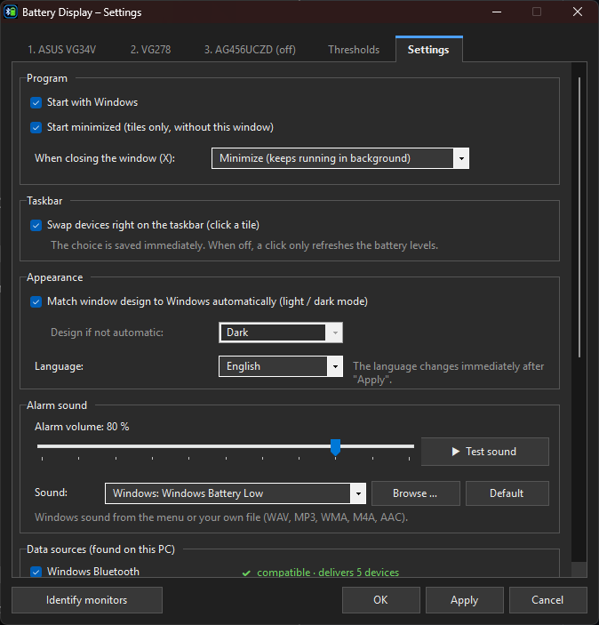

- **Program**
  - *Start with Windows*
  - *Start minimized* – tiles only, without the window
  - *When closing the window (X)*: minimize (keeps running) or exit the program completely
- **Taskbar**
  - *Swap devices right on the taskbar (click a tile)* – see [The tiles on the taskbar](#the-tiles-on-the-taskbar)
- **Appearance**
  - *Match window design to Windows automatically* (light / dark) or choose a fixed one
  - *Language*: English / Deutsch
- **Alarm sound**
  - *Alarm volume* (applies to every output device)
  - *Sound*: default warning tone, any Windows sound, or your own file via *Browse …*
  - *Test sound*
Further down on the same page:

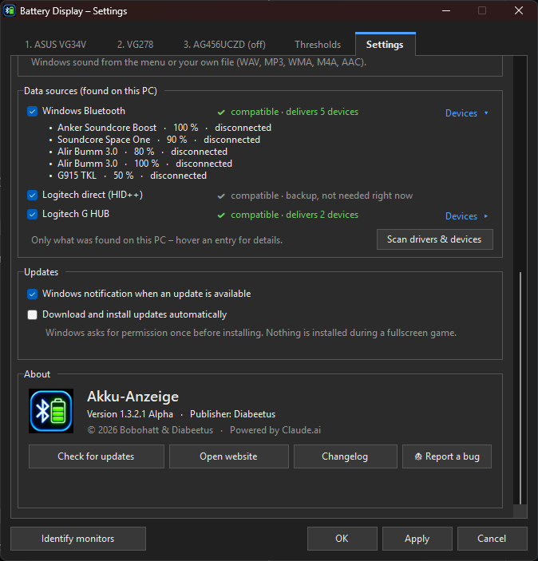

- **Data sources (found on this PC)** – only what actually exists on this PC: built-in readers appear only when matching hardware is connected, vendor software only when it is installed. Each source shows a live status (see [status messages](#status-messages-of-the-data-sources)). Click **Devices ▸** to see which devices a source delivers – with battery level and state. *Scan drivers & devices* finds software and devices added later: new ones appear marked *(new)* – check them and click *Apply*, no reinstall needed.
- **Updates**
  - *Windows notification when an update is available* – about one minute after start and then every 6 hours; clicking the notification opens the update window
  - *Download and install updates automatically* (off by default) – Windows asks for permission once; nothing is installed during a fullscreen game
- **About** – version, publisher, *Check for updates*, *Open website*, *Changelog*, *Report a bug* (see [About & update check](#about--update-check))

---

## Low battery warning

When a device drops below the alarm threshold, a warning window appears at the bottom right of **every monitor** – always on top, without taking focus away from a running game – together with the chosen warning sound:

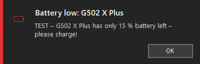

The warning does **not** use the Windows notification system, so it also appears with *Do not disturb*, muted notifications and in game mode. Once per device – again only after it has been charged. *OK* closes all warning windows and stops the sound.

---

## About & update check

The **About** section is at the bottom of the *Settings* tab (or right-click a tile → *About*):

- Version and publisher
- **Check for updates** – finds new versions; **Install update** downloads, verifies (signature + checksum) and installs them right inside the app – no browser needed
- **Changelog** – shows all changes directly in the app (also available as [CHANGELOG.md](CHANGELOG.md))
- **Report a bug** – a small window with two ways to GitHub: *Create issue* (report a bug, suggest an idea) or *Create pull request* (suggest a code change). Everything is filled in on GitHub (GitHub account needed).
- **Open website** – opens this page

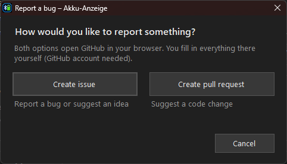

In addition, the app checks for updates on its own and shows a **Windows notification** when a new version is available – or installs it automatically if you turned that on (*Settings → Updates*).

---

## Installation

1. Download `AkkuAnzeige-Setup-<version>.exe` from **[Releases](https://github.com/Diabeetus94/Battery-Monitoring/releases)** and run it.
2. The setup lists the **installed, compatible driver software** – checked entries are linked.
3. Choose options (desktop shortcut, Start menu, start with Windows) → **Install**.

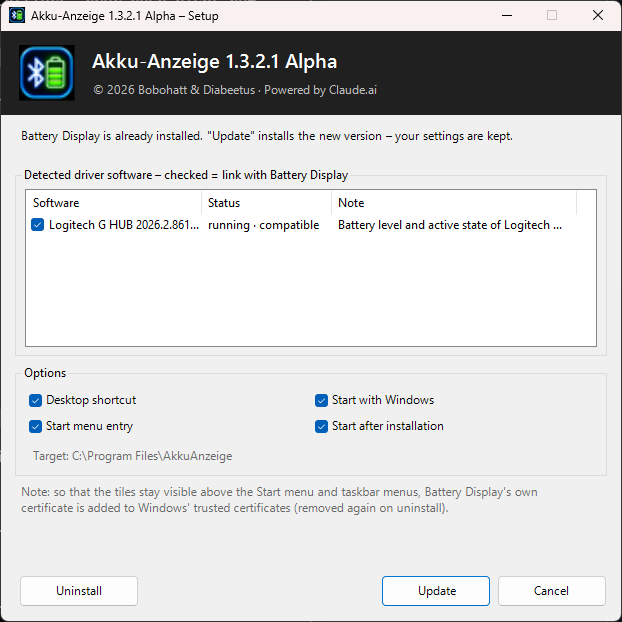

- Installs to `C:\Program Files\AkkuAnzeige`, with an entry in *Apps & features* for uninstalling.
- If a version is already installed, it is **updated** – your settings are kept.
- If compatible software is installed **after** the installation, Akku-Anzeige asks on its own whether to link it.
- The setup follows the Windows language; force a language with `/lang=en` or `/lang=de`.

> ℹ️ To keep the tiles visible above the Start menu and taskbar menus, the app uses the Windows *UIAccess* feature. For this, the setup adds Akku-Anzeige's own certificate to Windows' trusted certificates – it is removed again on uninstall. Windows may show "Windows protected your PC" on first launch: click **More info → Run anyway**.

---

## Supported data sources

| Source | Status | What is read |
|---|---|---|
| **Logitech G HUB** | ✅ compatible | battery level, charging, active / standby / off |
| **Windows Bluetooth** (built in) | ✅ compatible | battery level of headphones, speakers, phones … |
| **LGSTray** | ✅ fallback | Logitech battery levels if G HUB is not running |
| **Logitech direct** (HID++, built in) | ✅ compatible | LIGHTSPEED / Unifying / Bolt receivers and USB devices without G HUB: name, type, battery level, charging, on / off |
| **HyperX direct** (built in) | ✅ compatible | Cloud III S Wireless (dongle `03F0:06BE` / `02CC`) without NGENUITY: battery level, charging, on / off |
| **PlayStation DualSense** (built in) | ✅ compatible | USB always; Bluetooth as soon as a program such as Steam has switched the controller to its full report (read passively only) |
| **AirPods / Beats** (Bluetooth LE, built in) | ✅ compatible | earbud battery from their Bluetooth LE broadcasts (the emptier bud counts); scans only while an Apple audio device is connected |
| Razer Synapse, Corsair iCUE, SteelSeries GG, HyperX NGENUITY, ASUS Armoury Crate, Logitech Options+ | 🔍 detected | listed as *installed – but not compatible*; battery levels not supported yet |

All built-in sources only *read*: they never change settings on the device. Under *Settings → Data sources* only the sources found on this PC are listed.

### Status messages of the data sources

| Message | Meaning |
|---|---|
| ✔ **compatible · delivers 2 devices** (green) | works, battery levels are coming in – *Devices ▸* shows which ones |
| ✔ compatible · no device switched on right now | the connection works, but no device is on at the moment (e.g. mouse switched off, receiver unplugged) |
| ✔ compatible · backup, not needed right now | fallback source, e.g. *Logitech direct* while G HUB is running |
| ⚠ **compatible · program is not running** (orange) | e.g. G HUB is installed but not started |
| ⚠ **compatible · not responding right now** (orange) | the program is running but does not answer (e.g. while it is updating) |
| – compatible · turned off | you unchecked the source |
| ✖ **installed – but not compatible** (gray, no checkbox) | e.g. Razer Synapse or Corsair iCUE: detected, but we cannot read battery levels from it yet |

The status is updated every 5 seconds while the window is open.

> ℹ️ **Note on other manufacturers:** We cannot test every device and manufacturer ourselves. Razer, Corsair, SteelSeries, ASUS and other manufacturers usually do not share their devices' battery levels with other programs – support is planned, but can only be built reliably with test devices. Do you own such a device and want to help with testing? Please get in touch via an *Issue*.

---

## Usage

| Action | How |
|---|---|
| Open settings | desktop shortcut · double-click the notification area icon · right-click a tile |
| Swap the device on a tile | left-click the tile → choose a device |
| Refresh immediately | right-click a tile → *Refresh now* (or left-click, if swapping is turned off) |
| Switch tabs | click or `Ctrl + Tab` |
| Exit | right-click a tile or the notification area icon → *Exit* |
| Uninstall | *Settings → Apps → Akku-Anzeige → Uninstall* |

Settings are stored in `%APPDATA%\AkkuAnzeige\settings.json`.

---

## Building it yourself

Requirements: Windows 10/11 with .NET Framework 4.8 (the built-in compiler `csc.exe` is enough – no Visual Studio needed).

```powershell
powershell -ExecutionPolicy Bypass -File src\build.ps1 -noinstall
```

The script compiles the app and the setup, signs both with the local certificate "Akku-Anzeige Code Signing (lokal)" and puts the setup into `Setup\`. Without `-noinstall` it also installs locally to `Program Files` (UAC prompt).

| File | Content |
|---|---|
| `src/AkkuAnzeige.cs` | data sources (G HUB, LGSTray, Bluetooth), taskbar tracking, monitor detection, input activity |
| `src/Hid.cs` | raw HID access (enumeration, reading/writing with timeout) |
| `src/LogiHidpp.cs` | Logitech HID++ 2.0 (receivers and USB devices) |
| `src/DirectHid.cs` | HyperX Cloud III S Wireless, DualSense |
| `src/AppleBle.cs` | AirPods / Beats via Bluetooth LE advertisements (WinRT) |
| `src/Ui.cs` | tiles, settings window, design, alarm |
| `src/Info.cs` | About window and update check |
| `src/Lang.cs` | translations |
| `src/Vendors.cs` | detection of installed driver software, links |
| `src/Setup.cs` | installer |
| `src/AssemblyInfo.cs` | version and publisher (shared by app and setup) |

---

## Known limitations (Alpha)

- Battery levels from Razer, Corsair, SteelSeries, ASUS and other HyperX headsets are not read yet. NuPhy keyboards (2.4 GHz dongle `19F5:2620`) can't be read either – NuPhy's protocol is encrypted and their own software doesn't show the battery of these models.
- DualSense over Bluetooth only shows a battery level while a program such as Steam is using the controller (switching it ourselves would break DirectInput games until the controller is power-cycled).
- In games running in **exclusive** fullscreen no window can appear on top – you only hear the warning sound there (borderless fullscreen works).
- Logitech standby is detected as soon as the device disconnects from its receiver; if only the lighting turns off, it still counts as active (optionally adjustable).

---

<sub>Akku-Anzeige · © 2026 Bobohatt & Diabeetus · Powered by Claude.ai</sub>
